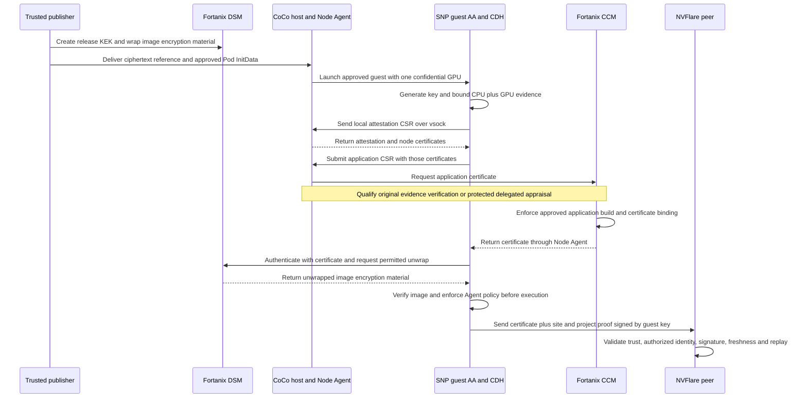

# NVFlare 2.9 integration with Fortanix CCM and DSM

Integrate Fortanix through the CoCo guest plugins `ccm_as` and `ccm_kbc`, then add a Fortanix authorizer for NVFlare peer verification. The first target is AMD SEV-SNP with one NVIDIA confidential GPU. Workload authorization and federation admission remain separate decisions.

The supplied implementation provides the basic certificate and image-decryption flow. It does not establish equivalence with NVFlare's current Trustee policies. The conditions for that equivalence are certificate identity tied to an approved workload, CPU and GPU appraisal, attestation freshness, exact resource permissions, and enforcement of the approved guest policy.

This is a proposed design and source assessment dated October 6, 2026. Hardware acceptance, CCM certificate contents, and live CCM/DSM policy behavior require the tests below.

## Reviewed baselines

| Component | Source revision |
| --- | --- |
| NVFlare `2.9` | `4928d76f21dafd64fe5eb41eff9c196e28c70aaa` |
| Fortanix guest-components `beta/0.21.0-fortanix-ccm-0.2.0` | `d3ae8f2c572e474d7fd36b76ba4f10042c05fefd` |
| Fortanix attestation SDK used by that branch | `fade7bf57c93fefaeaca77fe453b87a7909c9cd4` |

The [Fortanix SNP deployment guide](https://support.fortanix.com/docs/deploy-confidential-container-coco-workloads-on-amd-sev-snp-platform) currently specifies Helm chart 0.21.0 with `fortanix/kata-deploy:0.21.0-fortanix-ccm-0.2.12`. That deployment tag and the supplied source branch have different version labels. Obtain the artifact digests, embedded Kata version, guest-components revision, and SDK revision before approving a runtime. No correspondence between that image and the reviewed commit is established here.

The [CoCo RFC](https://github.com/confidential-containers/guest-components/issues/1513) describes a proposed design. The supplied branch determines the APIs assessed below.

## Components and trust boundaries

| Responsibility | Current NVFlare workflow | Proposed Fortanix workflow |
| --- | --- | --- |
| Collect CPU and GPU evidence | Guest AA and attesters | Guest AA with `ccm_as`, which invokes the Fortanix attestation SDK |
| Appraise evidence and approve references | Trustee AS, RVPS, and policies | Independently administered CCM application and build policies |
| Authorize protected resources | KBS resource policies | DSM application permissions and resource isolation, relying on CCM-issued identity |
| Decrypt image encryption metadata | CDH with `cc_kbc` | CDH with `ccm_kbc`; DSM decrypts wrapped image encryption material |
| Authenticate confidential peers | `CoCoAuthorizer` verifies Trustee EAR and a guest-key signature | New `FortanixAuthorizer` verifies the CCM certificate and a guest-key signature |
| Enforce effective container requests | Kata Agent policy in approved InitData | Retain and qualify the same class of guest policy controls |

AA and CDH remain CoCo components; the Fortanix modules are compiled features and configured plugins inside the approved guest. A RuntimeClass name does not establish which guest binaries are installed.

The cluster operator controls the host, Kubernetes, networking, and the host Node Agent. The [SDK certificate exchange](https://github.com/fortanix/attestation/blob/fade7bf57c93fefaeaca77fe453b87a7909c9cd4/client/src/lib.rs) has two stages: it obtains attestation and node certificates from the Node Agent, then includes those certificates in an application CSR. The Node Agent's role exceeds simple forwarding. Preserving NVFlare's adversarial-host threat model requires either independent CCM verification of the original hardware evidence and key binding, or a protected delegated verification result that the host cannot forge. This property requires qualification. DSM and NVFlare peers must validate their respective certificate trust independently; host enrollment alone cannot authorize a workload.

The workload publisher, platform reference authority, and CCM/DSM policy administrators retain their existing trusted roles. They must control application approval, reference provenance, identity authorization, and key custody independently of CoCo IT.

## Proposed launch and federation flow

Image processing can interleave signature checks, resource retrieval, and layer decryption. Acceptance requires all applicable guest checks to pass before the application runs; the diagram does not prescribe their internal order.

## NVFlare authorizer design

The existing [CoCoAuthorizer](https://github.com/NVIDIA/NVFlare/blob/4928d76f21dafd64fe5eb41eff9c196e28c70aaa/nvflare/app_opt/confidential_computing/coco_authorizer.py) requests `token_type=kbs`, reads `token` and `tee_keypair`, verifies a Trustee EAR, and signs a proof with its attested key. The Fortanix [token getter](https://github.com/fortanix/guest-components/blob/d3ae8f2c572e474d7fd36b76ba4f10042c05fefd/attestation-agent/attestation-agent/src/token/ccm_as.rs) instead returns JSON containing `cert_pem` and `key_pem`.

Add a separate authorizer with its own namespace, provisioned trust, and format version. Request `http://127.0.0.1:8006/aa/token?token_type=ccm_as` from inside the guest. Confirm that the installed REST gateway enables this route. Disable environment proxies and redirects, preserving the existing authorizer's local transport restrictions. Read the private key only into process memory and verify that it matches the certificate public key. Forward only the certificate chain and signed proof.

Loopback access does not authenticate the calling process. The [REST gateway](https://github.com/fortanix/guest-components/blob/d3ae8f2c572e474d7fd36b76ba4f10042c05fefd/api-server-rest/src/router.rs) returns the credential to any admitted loopback caller, and AA shares its cached credential across requests. The initial profile therefore trusts all processes able to access guest loopback and permits one reviewed application container. Introducing untrusted helpers or additional containers requires caller access control and separate credential isolation.

A proposed proof contains a version, certificate chain, signed `sub` site name, project-specific `aud`, `iat`, `exp`, and random `jti`. Its expiration cannot exceed certificate validity or the locally configured proof lifetime. The SDK currently generates RSA-3072 keys, so RS256 is a candidate signing algorithm; verification must select an allowed algorithm from the validated key and local policy.

Each verifier must:

1. Validate the X.509 path to an independently provisioned CCM trust anchor, including validity, CA constraints, permitted usages, and supported algorithms. Leaf or intermediate certificates supplied by the peer cannot become trust anchors.
2. Match certificate identity to a locally provisioned site, application, and permitted workload release. A shared DNS SAN or a certificate signed by the Zone CA is insufficient by itself.
3. Validate the proof signature and require its signed site to equal the authenticated logical FL site after the provisioned transport-identity mapping. The root server's logical site is `server`, while its transport certificate may identify the server hostname. Preserve `require_site_binding: true` in generated managers.
4. Validate project audience, timestamp types, bounded clock skew, lifetime, certificate status, and any separately established attestation-age policy.
5. Reject replayed proof IDs and malformed or oversized responses. Preserve bounded retries and fail on invalid identity or policy rather than retrying indefinitely. The existing replay cache applies within one verifier process and proof lifetime; it does not survive restart or provide verifier-challenge freshness. Stronger replay protection needs an explicit challenge protocol or durable state and corresponding tests.

The [CCManager](https://github.com/NVIDIA/NVFlare/blob/4928d76f21dafd64fe5eb41eff9c196e28c70aaa/nvflare/app_opt/confidential_computing/cc_manager.py) already calls `verify_for_site` and supports locally provisioned required verifiers per site. Reuse those interfaces, generation budgets, and failure handling. Configure ordinary participants with verifier-only components, and protected participants with issuer and verifier components.

The present CCM payload exposes no EAR-style appraisals or normalized measurement fields directly. Choose one explicit trust contract: a CCM-certified identity whose issuance policy guarantees the required build and CPU/GPU checks, or an additional signed attestation result that peers can validate. Do not accept unsigned measurement JSON or infer a successful GPU appraisal from certificate presence alone.

## Workload packaging and service configuration

The [CoCo provisioner](https://github.com/NVIDIA/NVFlare/blob/4928d76f21dafd64fe5eb41eff9c196e28c70aaa/nvflare/lighter/cc_provision/impl/coco.py) currently permits only `CoCoAuthorizer` and requires `trustee_public_key_file`. Introduce an explicit backend selection, such as `attestation_backend: fortanix`, with separate validation and trust inputs. This is a proposed configuration extension.

Retain signed startup kits, restricted private staging, immutable image references, and the packager's public handoff discipline. Add Fortanix-specific publisher and policy generation paths where the existing scripts require KBS resources or Trustee policy fragments.

Use a fresh DSM KEK per immutable release for the initial integration. The provider defaults to one KEK per layer. To use one KEK per release, select `--kek-mode shared` in a fresh provider process dedicated to that release, or precreate a fresh KEK and pass its canonical `keyid`. Reusing a shared-mode provider across releases would reuse its KEK. Restrict the publisher to its required creation and encryption operations; restrict the workload identity to decrypting that release's wrapped encryption material. The supplied [keyprovider](https://github.com/fortanix/guest-components/blob/d3ae8f2c572e474d7fd36b76ba4f10042c05fefd/attestation-agent/coco_keyprovider/src/enc_mods/dsm.rs) creates non-exportable AES-256 KEKs and emits `kbs:///dsm/key/<uuid>` with `provider: dsm`, wrapped data, IV, and authentication tag. Retain cosign signing and verify that every encrypted layer uses the approved release's KEK.

The [DSM client](https://github.com/fortanix/guest-components/blob/d3ae8f2c572e474d7fd36b76ba4f10042c05fefd/confidential-data-hub/kms/src/plugins/kbs/ccm_kbc/dsm_client.rs) has separate operations for exporting a resource and decrypting wrapped encryption material. Keep KEKs non-exportable; the image path should use the decrypt operation. Returning layer decryption material to the approved guest is required even when its wrapping KEK remains inside DSM.

Generate final InitData containing Fortanix AA and CDH configuration, registry trust, image verification policy, and Kata Agent policy. The documented configuration includes `token_configs.ccm_as.ccm_domain_names`, `kbc.name = "ccm_kbc"`, a DSM endpoint, and `kbc_configs.ccm_kbc.dsm_app_id`. The source also accepts optional `ccm_appconfig_id`; obtain its exact policy semantics before using it as an identity pin. Qualify the guest launcher: it must check the final InitData against its hardware binding and load that exact configuration into AA, CDH, and the Agent. The `ccm_as` token path does not take InitData plaintext; AA's explicit local binding check depends on its startup arguments.

Current NVFlare scripts fetch both the image verification policy and cosign public key through KBS. For the first integration, place these public inputs directly in attestation-bound InitData: the reviewed branch supports inline `image_security_policy`, and its [cosign verifier](https://github.com/fortanix/guest-components/blob/d3ae8f2c572e474d7fd36b76ba4f10042c05fefd/image-rs/src/signature/policy/cosign/mod.rs) reads inline `keyData` as PEM bytes. Remove `image_security_policy_uri` when choosing the inline policy because the URI takes precedence. Qualify this flow before relying on it. Public signing material requires integrity and approval, but no confidentiality. Future runtime secrets need separate DSM object permissions and retrieval tests.

Register the final InitData identity and approved platform references in CCM. Require GPU verification for this target. Independently establish SNP measurement, VMPL, debug policy, firmware/TCB requirements, and GPU security policy; translating Trustee Rego to CCM configuration needs an explicit mapping.

## Security gaps and required decisions

| Gap | Evidence or uncertainty | Required resolution |
| --- | --- | --- |
| Certificate identity and workload authorization | AA returns a certificate and key. Requested SANs come from configuration; the issued certificate's build identity and policy extensions have not been inspected. | Obtain a redacted real chain and extension schema. Prove CCM limits SAN issuance to the intended approved application/build. Map each FL site to an authenticated identity and permitted release. Test cross-application and cross-site impersonation. |
| Attestation freshness | AA caches the credential until certificate expiration, without a separate attestation TTL. A fresh NVFlare proof can contain an older credential. Certificate issuance time is not automatically a verified hardware-attestation timestamp. | Establish certificate lifetime, actual evidence freshness, renewal controls, and revocation behavior. A 300-second proof does not provide a 300-second attestation guarantee. Do not silently relax the current EAR age policy. |
| CPU and GPU policy equivalence | The pinned SDK binds public-key hash, coprocessor evidence, and optional AppConfig ID into SNP report data. It continues when GPU evidence collection fails. CCM server verification and policy enforcement remain to be qualified. | Require successful GPU verification in CCM and deny missing or invalid GPU evidence. Verify report-data binding, TCB floors, debug rejection, VMPL, GPU mode and firmware requirements. |
| InitData binding | NVFlare uses SHA-256. Fortanix's sample uses SHA-384; SNP HOST_DATA is 32 bytes and the reviewed SNP binding code truncates longer digests through `pad`. Token generation does not itself establish effective InitData enforcement. | Qualify the exact guest/launcher/CCM transformation and verify the launcher loads the checked configuration. Prefer retaining SHA-256 if supported. Register the final bound value and prove modified policy or service configuration is denied. |
| Resource authorization | Trustee release rules bind exact resource paths and InitData. The plugin uses DSM application authentication and DSM object operations. | Demonstrate equivalent restriction with application permissions, groups, or object controls. A valid certificate for one release must not decrypt another release's KEK or export unrelated resources. |
| Image and Agent policy coverage | The existing NVFlare architecture already documents an unresolved comparison between the effective image digest and approved digest. Fortanix's simple launch examples do not establish the full guest policy contract. | Retain default-deny signature checks, distinct release KEKs, command and security-context controls. Test effective image substitution, exec, mounts, environment and privilege changes. Close the digest gap before claiming universal image substitution rejection. |
| Runtime and policy generator compatibility | Guest-components, Kata deployment image, kernel, GPU libraries, and genpolicy must form one approved baseline. NVFlare's generator contains version-specific rule adjustments. | Pin all artifacts and qualify new measurements and policy behavior. Confirm equivalent mitigation for the [Kata genpolicy advisory](https://github.com/kata-containers/kata-containers/security/advisories/GHSA-fmg6-v47x-52wr); do not apply textual patches blindly to a different rules version. |
| Node Agent trust | Enrollment consumes Node Agent attestation/node certificates before obtaining the application certificate. Host resistance of that local appraisal is not established. | Prove independent CCM verification or protected delegated appraisal. Test forged local results and replayed evidence. If host-controlled signing authority can authorize arbitrary guests, this threat model is unmet. |
| Private-key API and service failures | The guest REST credential contains a private key and is available to guest loopback callers. | Trust all initial-profile callers or add access control and credential isolation. Keep the API guest-local, disable proxies/redirects, bound responses, suppress credentials in logs/errors, and test forged replies and outages. Keys, DSM publisher credentials, and plaintext kits must stay outside the cluster handoff. |

The [SDK evidence builder](https://github.com/fortanix/attestation/blob/fade7bf57c93fefaeaca77fe453b87a7909c9cd4/attestation/src/tpm_snp/generate_evidence/baremetal_snp.rs) establishes the client-side binding described above. It does not establish CCM's verification behavior. The [SNP binding code](https://github.com/fortanix/guest-components/blob/d3ae8f2c572e474d7fd36b76ba4f10042c05fefd/attestation-agent/attester/src/snp/mod.rs) and [padding helper](https://github.com/fortanix/guest-components/blob/d3ae8f2c572e474d7fd36b76ba4f10042c05fefd/attestation-agent/attester/src/utils.rs) establish why InitData encoding must be checked.

Existing limitations continue to apply: revocation cannot erase plaintext or keys already released, an operator can stop workloads, and attestation does not prove application privacy or correct training. Certificates and proof checks do not supply anti-cloning or persistent-state rollback protection.

## Implementation sequence

| Stage | Deliverable | Completion condition |
| --- | --- | --- |
| 1. Resolve Fortanix contracts | Version manifest, certificate schema, identity policy, renewal behavior, and security policy mapping | The gaps involving identity, freshness, and policy have explicit enforceable answers. |
| 2. Qualify a minimal encrypted workload | Pinned SNP/GPU runtime, approved references and final InitData, release KEK, signed encrypted image | CCM CPU/GPU approval and DSM decrypt succeed; initial negative release tests fail as expected. |
| 3. Implement peer verification | New authorizer, explicit provisioning backend, private-key-safe guest API client, verifier-only kits | Offline certificate/proof and provisioning tests pass; identity and expiry checks fail closed. |
| 4. Integrate packaging | Fortanix publisher, inline public image policy, release authorization record, public and private handoffs | A generated protected client kit becomes an approved encrypted workload without exposing private kit data to CoCo IT. |
| 5. Validate the federation | Ordinary trusted server and two protected SNP/GPU clients, then a protected server | Training uses the GPU, periodic proofs and certificate renewal work, and the negative matrix passes. |

Use an ordinary trusted server for the first federation to isolate client integration. Its memory and aggregation remain trusted to its administrator. Two protected clients are needed to exercise cross-site verification; a single client can validate the earlier launch milestone.

## Acceptance tests

| Area | Positive case | Negative cases and required result |
| --- | --- | --- |
| Certificate and proof unit tests | Valid pinned chain, permitted site identity, matching key, project audience and current proof | Reject untrusted root, forged or expired cert, mismatched private key, prohibited algorithm/usage, wrong SAN/application/release, wrong logical transport site or audience, oversized input, and replayed ID. Test replay after verifier restart and record the accepted limitation unless stronger replay protection is implemented. |
| CPU and GPU appraisal | Approved SNP launch plus required confidential GPU evidence obtains a credential | Deny changed boot measurement or InitData, debug-enabled or insufficient-TCB report, wrong VMPL, missing GPU, failed GPU evidence, invalid key/evidence binding, forged Node Agent results, and enrollment replay that would exceed the agreed evidence-age bound. |
| DSM permissions | Workload decrypts only its approved release's wrapped image material | Deny another release's KEK, another DSM app/group, KEK export, unrelated resource export, and corrupted IV/tag/ciphertext. |
| Guest image and Agent enforcement | Signed encrypted release runs with the approved command and UID/GID | Deny unsigned/corrupt image, another signed image with unchanged InitData, changed command/environment/privileges/mounts, exec, attach, and ephemeral debug access outside the approved contract. Track any uncovered digest case explicitly. |
| Credential lifecycle | Operate continuously beyond the permitted attestation age and across multiple certificate renewals, proving fresh evidence at required intervals | Define numeric attestation-age, renewal, poll, request-budget and skew limits; measure denial against that envelope. Exercise stale evidence, expired cert, outages and Node Agent replacement. After retiring a release and withdrawing CCM approval/DSM permission, deny fresh launch and renewal using its old signed image and InitData. |
| End to end federation | Two protected clients perform finite GPU training and verify each other's proofs; a protected server follows | Deny a client with invalid proof or substituted identity. Assign one visible GPU per client and correlate its approved evidence identity with the CUDA training device; CPU fallback fails acceptance. Collect CCM/DSM audit records and keep plaintext/private keys out of host-facing handoffs and logs. |

Offline tests validate adapters and policy logic; they cannot establish hardware confidentiality or CCM's server-side appraisal behavior. Retain version digests, approved reference provenance, sanitized certificate metadata, policy snapshots, DSM audit events, and federation test results as acceptance evidence.

## Questions for the Fortanix working session

1. Which deployment image digest corresponds to the supplied guest-components and SDK commits? Which Kata, kernel, GPU libraries, and policy generator does it embed?
2. What authenticated certificate fields identify the CCM application, build, approved CPU/GPU policy, and attestation time? Can another application request the same DNS SAN? What exactly does `ccm_appconfig_id` constrain?
3. Can certificate issuance and renewal enforce NVFlare's existing maximum attestation age? What are the default lifetime, force-refresh API, revocation mechanisms, and behavior of DSM sessions after revocation?
4. How does CCM enforce SNP TCB floors, debug/VMPL restrictions, and required GPU verification? Does missing GPU evidence always deny issuance for this target?
5. How are final InitData hashes encoded and checked for SNP when the configuration uses SHA-384? Is SHA-256 supported for this integration?
6. How should DSM permissions isolate each release's KEK and deny all unrelated decrypt/export operations? Can we provide a policy snapshot and automated negative tests?
7. Does the distributed guest enforce InitData Agent policy, inline image verification policy, and the current mount-rule security fixes? What supported configuration keeps the credential REST API accessible only inside the guest, and which guest callers can retrieve its key?
8. Where is original SNP/GPU evidence appraised during the two-stage Node Agent exchange? What prevents a hostile host or compromised Node Agent from forging a local attestation result or replaying old evidence to obtain a new certificate?

Answers to these questions determine whether the integration can preserve the required security guarantees.
